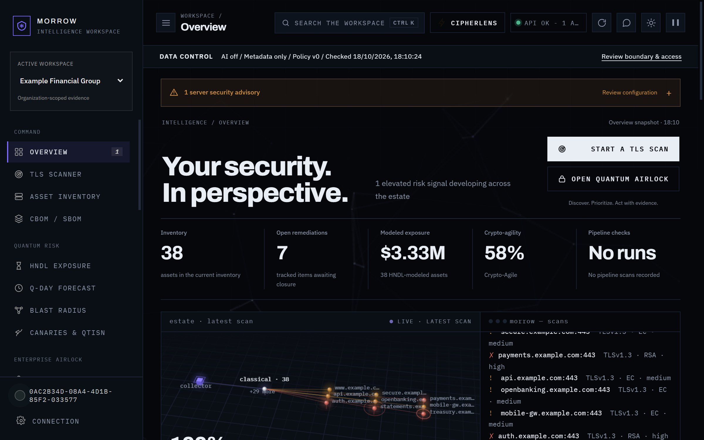
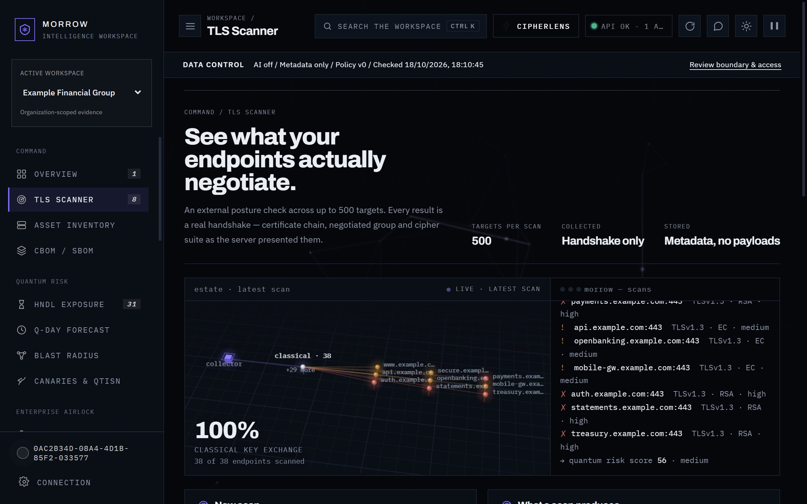
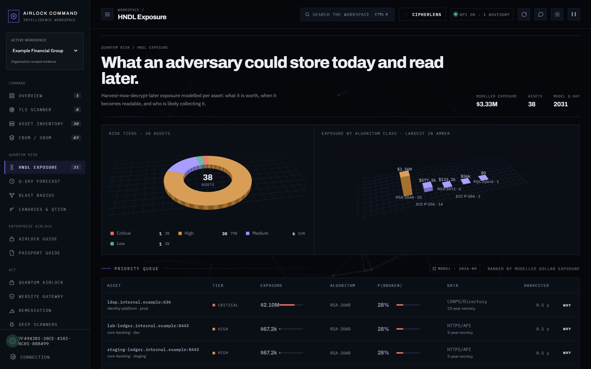

# Morrow

**Find the cryptography in your estate that a quantum computer will break, prove who owns it, and track it to replacement.**

Morrow is a post-quantum cryptography (post-quantum) governance platform. It discovers the
cryptography actually in use across TLS endpoints, certificates, source repositories and cloud
configuration; scores what is exposed; assigns each finding an owner; and follows it through
remediation to verified closure with an audit trail.

[](https://github.com/soqlab/morrow/actions/workflows/tests.yml)
[](LICENSE)



---

## Why this exists

Public-key cryptography — RSA, Diffie-Hellman, the elliptic-curve algorithms behind nearly every
HTTPS connection — is secure today because factoring large numbers and computing discrete logarithms
is slow on the computers we have. A sufficiently large quantum computer running Shor's algorithm
makes both fast. Nobody has built one yet.

That does not make it a future problem, for one reason: **harvest now, decrypt later**. An adversary
who records your encrypted traffic today can store it and decrypt it on the day such a machine
exists. Anything you send now that must stay confidential for a decade — patient records, legal
discovery, source code, state secrets, long-lived credentials — is already exposed if it crosses a
network protected only by classical public-key cryptography. The clock on that data started when it
was transmitted, not when the quantum computer arrives.

The deadlines are published:

| Date | Milestone |
|---|---|
| **2024** | NIST publishes the first post-quantum standards: FIPS 203 (ML-KEM), 204 (ML-DSA), 205 (SLH-DSA) |
| **2030** | NIST deprecates RSA-2048 and ECC-256 — [IR 8547](https://csrc.nist.gov/pubs/ir/8547/ipd) |
| **2035** | NIST disallows them entirely; US federal systems must have migrated |

Migration is not a patch. It is an inventory problem first: most organisations cannot answer "where
do we use RSA, in what, owned by whom, protecting data that matters for how long?" You cannot
migrate an estate you cannot enumerate. That inventory is what this platform builds.

## What it does

- **Discovery** — probes TLS endpoints and certificates for the key exchange, signature algorithm
  and key size actually negotiated. The TLS 1.3 key-exchange group is read by building a ClientHello
  by hand and parsing the ServerHello, because Python's `ssl` module cannot report hybrid groups
  like X25519MLKEM768 on the OpenSSL versions in deployment. Source repositories are scanned for
  crypto primitives, hardcoded secrets and certificate material; cloud configuration for
  KMS/HSM posture.
- **Quantum risk modelling** — scores each finding by algorithm, key size and how long the data it
  protects must stay confidential (harvest-now-decrypt-later exposure), not by algorithm alone.
- **Ownership and governance** — every asset carries an owner, team, environment, criticality and
  data lifetime, so a finding becomes someone's task rather than a line in a report.
- **Remediation workflow** — suggested → approved → PR created → verified closed, with drift checks
  that reopen a finding if it regresses.
- **CBOM export** — `GET /cbom` emits a CycloneDX 1.6 Cryptography Bill of Materials, validated
  against the official schema on every test run. Algorithms carry NIST CSOR OIDs and post-quantum security
  categories; `bom-ref` values are content-derived, so two exports of an unchanged estate diff
  cleanly.
- **Evidence** — signed remediation bundles, compliance reports and an append-only audit journal.
- **Quantum Airlock** — an onboarding path for reviewing a third party's posture without being given
  their source, payloads or secrets.

An optional AI assistant explains findings and drafts remediation plans. It is provider-agnostic:
Anthropic, OpenAI, Azure OpenAI, Gemini, Ollama, any OpenAI-compatible endpoint, or your own adapter
class. With no credential configured it falls back to an offline rule engine that needs no network,
and `MORROW_LLM_DISABLED=1` forbids any external call outright. Every other feature works without it.
See [docs/AI_PROVIDERS.md](docs/AI_PROVIDERS.md).

| | |
|---|---|
|  |  |
| Discovery and scan history | HNDL exposure by data lifetime |

## Quick start

Needs Docker. Nothing else — no `.env` to write, no database to install.

```bash
git clone https://github.com/soqlab/morrow.git
cd morrow
docker compose up --build
```

The console is at **http://localhost:8001/ui/**. The workspace starts empty, with honest empty
states, because you have not scanned anything yet.

To look around with data in it, seed an example estate:

```bash
docker compose run --rm seed
```

That creates "Example Financial Group", an invented company: 38 assets on reserved `example.com`
hostnames, eight scans of history, a CBOM, an HNDL model, canaries and a policy. Every row is
produced by the platform's own evaluation pipeline, so the dashboards are internally consistent
rather than hand-written numbers. No real organisation, hostname or person appears anywhere in it.

Press <kbd>Ctrl</kbd>+<kbd>K</kbd> for the command palette, or open **Guide & Tutorial** in the
sidebar — it documents every screen and needs no network access.

### Deploying it for real

[deploy/single-host/README.md](deploy/single-host/README.md) is the sequenced runbook for one VPS:
Postgres, Redis, the worker, the scheduler and Caddy for automatic TLS, with the production safety
checks and the go-live gate as the finish line. `docker-compose.prod.yml` on its own expects a
managed Postgres and a proxy you already run, which is right for a cloud deployment;
`deploy/single-host/compose.yml` is an overlay that adds both for a single box.

`infra/helm` and `infra/gcp/cloudrun` are there for when one box stops being enough.

[docs/LAUNCH_CHECKLIST.md](docs/LAUNCH_CHECKLIST.md) is what is left before putting it in front of
strangers, including the parts that are not engineering.

### Without Docker

```bash
cd backend
python -m venv .venv && .venv/bin/pip install -r requirements.txt   # .venv\Scripts\pip on Windows
.venv/bin/python -m uvicorn app:app --port 8001
```

The server starts with no configuration at all: it falls back to SQLite, runs scans in-process
rather than on a worker, and reports what is missing at `GET /health/deep` and under
**Administration → Launch readiness**. Each item names the environment variable that fixes it.

> **This default configuration is for a laptop, not a network.** `MORROW_AUTH_MODE=headers` means any
> caller can claim any role by setting a request header, and `MORROW_DEFAULT_ROLE=admin` means
> anonymous requests are admin. The server warns about both on every start. See
> [Security posture](#security-posture) before exposing it to anything.

## Configuration

Copy [`.env.example`](.env.example) to `backend/.env` and edit. Every setting is optional and
commented; the file is grouped by concern (database, auth, secrets, AI, background work, browser
security, integrations). For a real deployment use [`.env.prod.example`](.env.prod.example) instead,
which is the hardened template: external SSO, managed Postgres and Redis, strict CSP, real secrets.

## Architecture

A FastAPI application serves both the JSON API and the front end. The console is a single-page app
written in vanilla JavaScript with no build step and no CDN dependencies — the HTML, CSS and JS are
served as-is, which is why a clone needs no `npm install` to show a UI. State lives in SQLite by
default and Postgres when configured, behind one data-access layer that both back ends implement, so
a feature works the same either way. Scans run on a Celery worker when a Redis broker is reachable
and fall back to running in-process when it is not, so a single node works without Redis (that path
is not restart-safe). A separate Go service in `gateway/` provides a WAF and reverse proxy built on
Coraza and the OWASP Core Rule Set, used when the platform fronts a customer's website.

```
                    ┌──────────────────────────────────────────┐
  browser ─────────▶│  FastAPI (backend/app.py)                │
                    │                                          │
                    │  /ui/        customer console (SPA)      │
                    │  /vendor-admin/  operator portal (SPA)   │
                    │  /v1/...     JSON API                    │
                    │  /cbom       CycloneDX 1.6 export        │
                    └───┬───────────────┬──────────────────┬───┘
                        │               │                  │
              ┌─────────▼──────┐  ┌─────▼──────┐  ┌────────▼────────┐
              │ scanner.py     │  │ data layer │  │ services/llm/   │
              │ TLS probe      │  │ SQLite  OR │  │ provider-       │
              │ cert parse     │  │ Postgres   │  │ agnostic AI     │
              │ repo scan      │  │ (+RLS)     │  │ (optional, off) │
              │ cloud posture  │  └─────┬──────┘  └─────────────────┘
              └───────┬────────┘        │
                      │            ┌────▼─────┐
                 ┌────▼─────┐      │ audit    │
                 │ Celery   │      │ journal  │
                 │ worker   │      │ (append- │
                 │ (or in-  │      │  only)   │
                 │ process) │      └──────────┘
                 └──────────┘
```

| Path | What lives there |
|---|---|
| `backend/` | The application: API, scanners, services, migrations, tests |
| `backend/static/` | Customer console (SPA) and public pages |
| `backend/static_admin/` | Operator portal (SPA) |
| `backend/services/llm/` | AI provider adapters |
| `gateway/` | Go WAF and reverse proxy (Coraza + OWASP CRS) |
| `infra/` | Terraform for Cloud Run |
| `demo/` | Example-estate seeder, screenshots, video scripts |
| `docs/` | Reference documentation |
| `scripts/` | Operational and verification scripts |

## Running the tests

```bash
cd backend
pip install -r requirements.txt -r requirements-dev.txt
pytest -q
```

The suite needs no credentials and no services. Tests that require a real Postgres, Redis or
third-party API skip cleanly rather than fail; set `MORROW_TEST_PG_DSN` or `MORROW_TEST_REDIS_URL` to make
them run instead. Lint with `ruff check .` from `backend/` — the rules live in `backend/ruff.toml`
so the same command runs locally and in CI.

## Security posture

- **Multi-tenant isolation** is enforced in the data layer and, on Postgres, additionally by
  row-level security with a non-superuser application role. `GET /admin/postgres-rls/verify`
  reports whether it is actually active.
- **Secrets at rest** — integration credentials (webhook URLs, cloud keys, routing keys) are sealed
  with Fernet under `MORROW_VAULT_MASTER_KEY` before they reach the database. Without that key the
  features that store credentials refuse to save rather than writing them in the clear.
- **Outbound requests** go through an SSRF guard: HTTPS only, every resolved address must be
  public, the checked address is the address connected to (so DNS rebinding cannot redirect it
  inward), and redirects are not followed.
- **Audit journal** is append-only and records the acting operator for every administrative action.
- **Production refuses to start** misconfigured. With `MORROW_ENVIRONMENT=production` the entrypoint
  requires external JWT/SSO, managed Postgres and Redis, a vault key and explicit allowed hosts.

The defaults in the quick start are deliberately permissive for local use and the server says so on
every start. Do not expose them.

To report a vulnerability, see [SECURITY.md](SECURITY.md). Please do not open a public issue for
one.

## Documentation

| Document | Covers |
|---|---|
| [docs/COMPLETE_DOCUMENTATION.md](docs/COMPLETE_DOCUMENTATION.md) | Everything, in depth |
| [docs/TRY_IT_ON_YOUR_MACHINE.md](docs/TRY_IT_ON_YOUR_MACHINE.md) | Local setup walkthrough |
| [docs/USER_GUIDE.md](docs/USER_GUIDE.md) | Using the console |
| [docs/API_REFERENCE.md](docs/API_REFERENCE.md) | Route inventory |
| [docs/AI_PROVIDERS.md](docs/AI_PROVIDERS.md) | Configuring an AI provider, adding an adapter |
| [docs/TECHNICAL_REFERENCE.md](docs/TECHNICAL_REFERENCE.md) | Codebase internals |
| [docs/DATA_MODEL_AND_OPERATIONS.md](docs/DATA_MODEL_AND_OPERATIONS.md) | Schema and operations |
| [docs/THREAT_MODEL.md](docs/THREAT_MODEL.md) | Threat model |
| [docs/SCANNER_ACCURACY_AUDIT.md](docs/SCANNER_ACCURACY_AUDIT.md) | What the scanner gets right and wrong, measured |
| [docs/PRODUCTION_DEPLOYMENT_RUNBOOK.md](docs/PRODUCTION_DEPLOYMENT_RUNBOOK.md) | Deploying for real |
| [docs/NON_TECHNICAL_EXPLANATION.md](docs/NON_TECHNICAL_EXPLANATION.md) | The plain-English version |

## Status and scope

This is a working platform with a large automated test suite, not a finished commercial product.
Be aware of what it is not:

- It has **no security certification** — no SOC 2, no ISO 27001, no third-party penetration test.
- Scanner accuracy is measured and documented honestly, including where it is wrong, in
  [docs/SCANNER_ACCURACY_AUDIT.md](docs/SCANNER_ACCURACY_AUDIT.md). Read it before trusting an
  output.
- Some analytics endpoints have known scale ceilings on large estates.
- The AI assistant is optional and off by default; nothing depends on it.

Where the platform cannot determine something, it reports that it does not know rather than
guessing. Empty states say "no data yet" instead of showing a zero that looks like a measurement.

### What it costs

Nothing, in both senses. The platform is MIT-licensed, so you can run your own copy, modify it and
redistribute it. The instance we host is also free: no card, no paid tier, nothing withheld behind
one. Rate limits exist because capacity is finite, not as an upsell.

The honest other half: **there is no service-level agreement on the hosted instance.** Nobody is on
call, it is run by one operator, and it may be slow or down. If post-quantum readiness is on a
schedule your organisation is accountable for, run your own copy — that is what the licence is for,
and it does not depend on anyone's goodwill.


### Getting an account

There is no self-service signup, and that is deliberate rather than unfinished. An authenticated
account can scan arbitrary hosts, and none of the free checker's guardrails — one endpoint, port
443, an opt-out honoured before DNS — apply to the full scanner. Open signup would make any
deployment of this a free reconnaissance service pointed at other people's infrastructure.

So `/trial` records a request and an operator approves it from the admin portal, which creates the
organization and issues a single-use invitation. `/auth/register` stays admin-only. If you
self-host and want open signup, the design that makes it safe is to limit scanning to domains an
account has proved it controls (DNS TXT or a served file); that verification is not built yet.

### Free public readiness check

A **free check anyone can run** — enter a domain, get its post-quantum posture, no account — ships
in this repository at `/check`, with a terminal equivalent in `scripts/pq-check.py`. It reads
public Certificate Transparency records, then makes at most two TLS connections to that hostname on
port 443: exactly what a browser does when it visits the site. No port scanning, no subdomain
discovery, no vulnerability probing. The repository, cloud and credentialed scanners stay behind
authentication.

It is **enabled by default for self-hosters** and **not yet switched on for our own public site**.
Running a service that connects to third-party hosts at an anonymous stranger's request is a
different responsibility from scanning your own estate, and these have to exist first: terms that
bind without a signup step, a published acceptable-use policy, a monitored abuse address with an
honoured opt-out, a privacy notice covering both the person asking and the party being checked, and
a scanner-identity page so operators can recognise the traffic. If you self-host it, those are
yours to provide, along with your own jurisdiction's rules.

Every completed check is also **recorded permanently** at `/r/{domain}`: a server-rendered page a
search engine can index and a link preview can read, the history of what that endpoint's
cryptography changed to and when, both exports, and a badge to embed in a README. Reading any of
it serves stored data — a crawler, a shared link or a badge view can never start a check.

The guardrails are code, not promises: an opt-out checked before DNS resolution, refusal of private,
loopback, link-local and cloud-metadata addresses, rate limits per visitor, per target domain and
overall, result caching so a popular domain is checked once rather than once per visitor, and a
bounded queue. An opt-out deletes the cached result and hides the record, for the domain and every
subdomain. Every default and its setting is in
[docs/PUBLIC_CHECKER.md](docs/PUBLIC_CHECKER.md); what the registry does and does not yet do is in
[docs/PUBLIC_REGISTRY_DESIGN.md](docs/PUBLIC_REGISTRY_DESIGN.md).

## Contributing

See [CONTRIBUTING.md](CONTRIBUTING.md) for setup, the house style, how to add a scanner check or an
AI adapter, and what a reviewable pull request looks like. By participating you agree to the
[Code of Conduct](CODE_OF_CONDUCT.md).

## Licence

MIT — see [LICENSE](LICENSE). Copyright (c) 2026 Yasseen Nandally.

Third-party dependency licences and attribution notices are in
[THIRD_PARTY_NOTICES.md](THIRD_PARTY_NOTICES.md).
